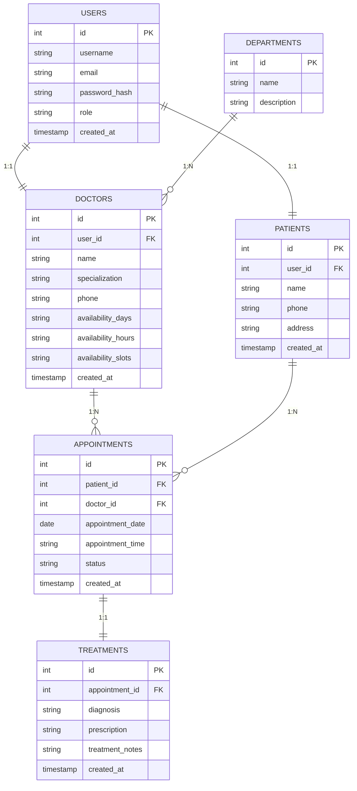

# Author
 ### Name: Aditya Raj
 ### Roll No: 23f3002964
 ### Email: 23f3002964@ds.study.iitm.ac.in

# Hospital Management System - Project Report

## 1. Project Details

### Question Statement
The project involves developing a comprehensive hospital management system that facilitates efficient management of doctors, patients, appointments, and medical records. The system should support role-based access control for administrators, doctors, and patients, with each role having specific functionalities and dashboards.

### Approach to Problem Statement
We developed a web-based hospital management system using the Flask framework in Python. Our approach involved:

1. **Database Design**: Created a normalized relational database with tables for users, doctors, patients, appointments, treatments, and departments using SQLAlchemy ORM.

2. **Modular Architecture**: Implemented a modular structure by separating route handlers into a dedicated routes.py file for better code organization and maintainability.

3. **Role-Based Architecture**: Implemented a three-tier role system (admin, doctor, patient) with distinct dashboards and permissions.

4. **Security Implementation**: Added input sanitization, password hashing, and session management for secure authentication.

5. **User Experience**: Designed intuitive interfaces using Bootstrap 5 for responsive design across devices.

6. **Core Functionalities**: Developed features for appointment booking, availability management, medical history tracking, and administrative controls.

## 2. Frameworks and Libraries Used

### Backend Framework
- **Flask 2.3.3**: Main web framework for building the application
- **Flask-SQLAlchemy 3.0.5**: ORM for database operations and data persistence
- **Hashlib**: For secure password hashing using SHA-256
- **datetime**: For date and time management
- **functools**: For implementing decorators
- **re**: Regular expressions for input validation

### Frontend Technologies
- **Bootstrap 5**: CSS framework for responsive design
- **Bootstrap Icons**: Icon library for UI elements
- **HTML5/CSS3**: Markup and styling
- **JavaScript**: Client-side validation and interactivity

### Python Dependencies
- **Werkzeug 2.3.7**: WSGI utility library for Flask
- **Jinja2 3.1.2**: Template engine for rendering HTML
- **MarkupSafe 2.1.3**: Safe string handling for templates
- **itsdangerous 2.1.2**: Secure data serialization
- **click 8.1.7**: Command line interface creation
- **blinker 1.6.3**: Signal/event dispatching

## 3. ER Diagram of Database
 [Drive Link for Visualisation](https://drive.google.com/drive/folders/1KA68K-JBuVjftazCqnVpR9yQJbKR9_s1?usp=sharing)

## 4. API Resource Endpoints

### Authentication Endpoints
- `GET /` - Redirects to appropriate dashboard based on user role
- `GET/POST /login` - User authentication
- `GET/POST /register` - Patient registration
- `GET /logout` - User logout

### Admin Endpoints
- `GET /admin/dashboard` - Admin dashboard
- `GET /admin/doctors` - Manage doctors
- `GET/POST /admin/doctors/add` - Add new doctor
- `GET/POST /admin/doctors/edit/<int:doctor_id>` - Edit doctor details
- `POST /admin/doctors/delete/<int:doctor_id>` - Delete doctor
- `GET /admin/patients` - Manage patients
- `GET /admin/search` - Search functionality

### Doctor Endpoints
- `GET /doctor/dashboard` - Doctor dashboard
- `GET /doctor/appointments` - View all appointments
- `GET /doctor/availability` - Set weekly availability
- `GET /doctor/advanced-availability` - Set advanced availability
- `GET /doctor/patient/<int:patient_id>/history` - View patient medical history
- `GET/POST /doctor/appointment/<int:appointment_id>/update-history` - Update patient history
- `POST /doctor/appointment/<int:appointment_id>/complete` - Mark appointment as completed
- `POST /doctor/appointment/<int:appointment_id>/cancel` - Cancel appointment

### Patient Endpoints
- `GET /patient/dashboard` - Patient dashboard
- `GET/POST /patient/profile` - View/update profile
- `GET /patient/history` - View medical history
- `GET /patient/departments` - Browse departments
- `GET /patient/department/<int:department_id>` - View doctors in department
- `GET /patient/doctor/<int:doctor_id>/availability` - View doctor availability
- `GET /patient/doctor/<int:doctor_id>/profile` - View doctor profile
- `POST /patient/book_appointment` - Book new appointment
- `POST /patient/appointment/<int:appointment_id>/cancel` - Cancel appointment
- `GET/POST /patient/appointment/<int:appointment_id>/reschedule` - Reschedule appointment

## 5. Key Features

### Role-Based Dashboards
- **Admin Dashboard**: Manage doctors, patients, and view system statistics
- **Doctor Dashboard**: Manage appointments, update availability, and record treatments
- **Patient Dashboard**: Book appointments, view medical history, and manage profile

### Security Features
- Password hashing using SHA-256
- Input sanitization to prevent XSS attacks
- Session-based authentication
- Role-based access control
- Parameterized database queries to prevent SQL injection

### Data Validation
- Frontend validation using JavaScript
- Backend validation using Python
- Email format validation
- Phone number format validation
- Password strength validation

### Database Management
- SQLAlchemy ORM for simplified database operations
- Object-relational mapping for clean data handling
- Automated database schema creation
- Relationship management between entities

### Modular Code Structure
- Separation of route handlers into dedicated routes.py file
- Improved code organization and maintainability
- Easier to extend and modify functionality

## 6. AI/LLM Usage in Development

### Bootstrap / CSS Styling and Layout (8%)

During the development of the user interface, AI/LLM assistance was utilized for:

1. **CSS Class Selection**: Assistance in selecting appropriate Bootstrap 5 classes for responsive layouts, such as:
   - Grid system classes (`col-md-*`, `row`, `container`)
   - Component classes (`card`, `btn`, `form-control`)
   - Utility classes (`mt-*`, `mb-*`, `text-*`, `bg-*`)

2. **Responsive Design Implementation**: Guidance on implementing responsive behaviors across different device sizes using Bootstrap's breakpoints.

3. **Component Styling**: Help with customizing Bootstrap components like:
   - Navigation bars with proper alignment
   - Card layouts with headers and footers
   - Form elements with proper spacing and validation states
   - Badge and button variations for different statuses

4. **Custom CSS Development**: Assistance in writing custom CSS rules in `style.css` for:
   - Color scheme consistency using CSS variables
   - Hover effects and transitions
   - Responsive adjustments for mobile views
   - Custom animations and keyframe definitions

5. **Accessibility Features**: Recommendations for implementing accessible UI elements that comply with WCAG standards.

### JavaScript / AJAX (Vanilla) Interactivity and Client-Side Logic (5%)

AI/LLM assistance was used for implementing client-side functionality:

1. **Form Validation Logic**: Development of comprehensive validation functions in `validation.js` for:
   - Email format checking using regular expressions
   - Phone number validation with international format support
   - Password strength requirements
   - Name and username length validations

2. **Event Handling**: Implementation of event listeners for form submissions and user interactions.

3. **AJAX Implementation**: Creation of asynchronous data fetching for the admin dashboard's auto-refresh feature:
   - Using the modern Fetch API for HTTP requests
   - JSON data parsing and DOM manipulation
   - Error handling for network requests

4. **DOM Manipulation**: Dynamic content updates without page refresh, specifically:
   - Table row generation for appointment listings
   - Date formatting functions
   - Conditional element display based on data availability

5. **Timing Functions**: Implementation of auto-refresh functionality using `setInterval()` and `setTimeout()`.

6. **Template Literals**: Use of ES6 template literals for dynamic HTML generation in JavaScript.

The AI/LLM assistance helped accelerate development by providing best practices, reducing research time, and suggesting efficient implementation approaches for both styling and client-side logic. However, all code was reviewed and customized to fit the specific requirements of the hospital management system.

## 7. Video link : [Hospital Management System](https://drive.google.com/drive/folders/1ilwUKoVS9RnRdwWmbWBCh8nDFsY2t3rS?usp=sharing)